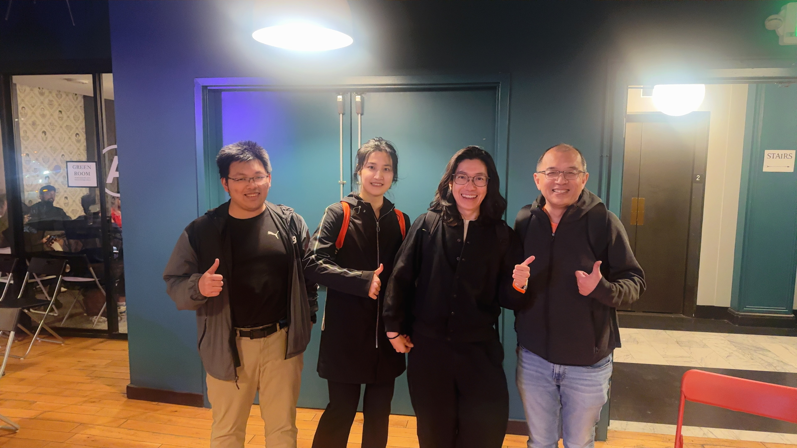
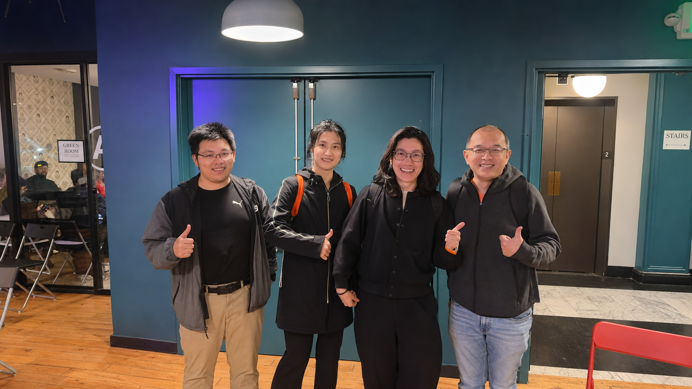

# Event Photo Retouch

> [!TIP]
> **Install in Codex**
>
> Run this in Terminal:
>
> ```bash
> curl -fsSL https://raw.githubusercontent.com/anne-creator/event-photo-retouch/v0.2.0/install.sh | bash
> ```
>
> macOS, Linux or WSL. The installer sets up Python if needed and downloads about 265 MB of local models. [Read the installer](install.sh).

A Codex skill for correcting light in event photos, followed by a light skin finish on eligible faces.

## Use

Attach original photos or give Codex their folder, then say:

> Use $event-photo-retouch on these photos.

Lighting comes first. The local renderer keeps the original image coordinates and dimensions. Small faces are skipped during skin finishing.

A new lighting reference needs Codex's image-editing tool. You can also supply an existing reference. Fully clipped detail cannot be recovered.

## Before and after

### Before



### After



The selected after image is a direct AI edit. [Image details](examples/selected-pair.json) include its source and dimensions; [earlier checks](examples/manifest.json) cover the source-pixel renders.

## Details

[Workflow and CLI commands](references/workflow.md) · [Setup and validation](references/setup-and-validation.md)

Code: [MIT](LICENSE). Model licenses: [NOTICE](NOTICE). Photographs are excluded from the software license.

中文：安装后直接上传原图，说“用 $event-photo-retouch 修图”。默认先修光，再做多人自然美颜，并提供前后对比。
